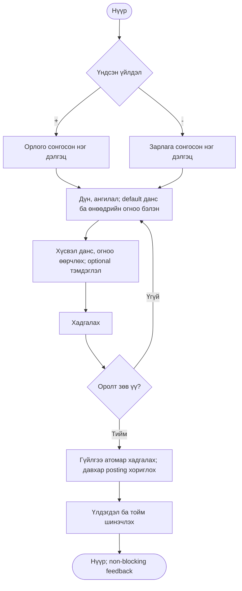
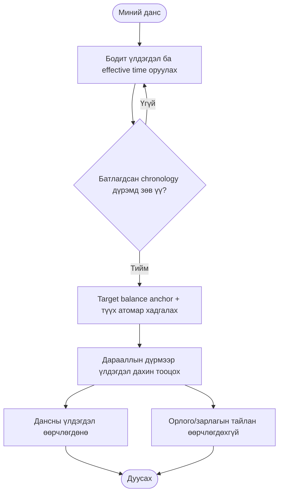
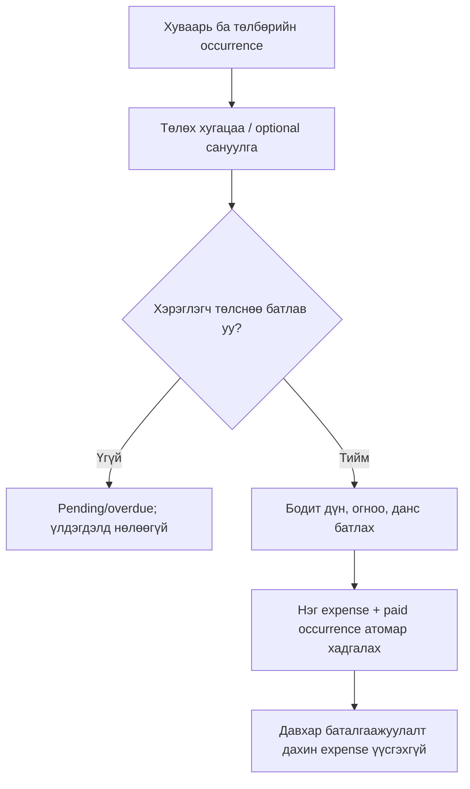
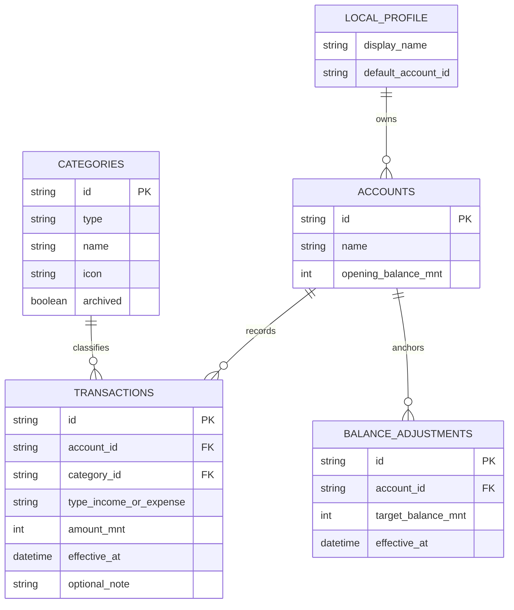

# HADGALY — PROJECT CONTEXT

Last Updated: **2026-11-03, Asia/Ulaanbaatar**

Current status: **Stage 1 accepted. Stage 2 implemented and verified for founder review; Stage 2 acceptance pending.**
CEO #011 supersedes earlier typography/color/navigation directions: Google Sans Flex + bundled Noto Sans
for missing Cyrillic/MNT glyphs, Midnight Blue/neutral/teal tokens, four persistent product tabs with
Finance selected initially. Only finance is functionally active; Tasks/Shopping/Ideas are coming-soon
UI only. See `STAGE2_DESIGN_NAV_REVIEW.md`. The approved finance six-stage roadmap is unchanged.
Latest Home revision: see `STAGE2_HOME_REVIEW.md`. The founder-approved Home now centers a neutral
expense-category donut with zero period totals, shows the combined current balance of all accounts,
and places expense left / income right above My Accounts navigation. No transaction capability was added.
The founder previously authorized a **fresh local start** after the integration-test incident;
previous incident data was not recovered. The founder's subsequently entered records were
**preserved exactly** during the latest Stage 2 Cupertino UI refinement. Financial/application,
repository, schema/migration source hashes are unchanged; schema remains v2.
See `STAGE2_UI_REFINEMENT.md` for the latest UI/test/demo evidence, and `STAGE2_REVIEW.md`,
`STAGE2_FINANCIAL_RULES.md`, historical `STAGE2_BLOCKER.md` for prior implementation context.

## Current directive overrides — 2026-11-03

### Latest authorization and verified resolution

- Latest authorized work is **CEO #011 Stage 2 design system and product navigation correction only**. Preserve finance behavior, Home hierarchy, default selection, records/audit/schema/migrations. Do not implement Stage 3 or future module models/persistence; Stage 2 remains unapproved.
- Future product vision: modular organization across **Хийх зүйл / Авах зүйл / Санаа / Санхүү**, Simple Yet Effective. Current MVP implementation and the approved six-stage roadmap remain finance-only. Any future roadmap expansion requires a separate product decision.
- Typography: official unmodified Google Sans Flex variable font; its cmap lacks Cyrillic and ₮. Official unmodified Noto Sans fallback supplies only missing glyphs, including Ө/Ү/өү and ₮. Both are bundled offline with SIL OFL notices; Google Sans Flex trademark notice retained. Official google/fonts source revision and SHA-256 manifest: assets/fonts/SOURCES.json. No proprietary/unofficial font files.
- Central tokens: neutral #F5F6F8, midnight #14243E, teal #39B5AA, expense #D66B72; light Cupertino presentation. 60/30/10 is composition guidance, not a pixel quota. Darker teal/error text variants preserve 4.5:1 contrast; main buttons use midnight text on teal/expense fills. See lib/core/presentation/design_tokens.dart.
- Four tabs appear after mandatory onboarding; Finance is initially selected on every launch. Other modules show “Тун удахгүй” only. A nested finance navigator keeps the bar on account/detail/form routes and preserves unsaved form state while switching tabs. Android Back on another tab returns to finance; Back within finance pops its local route. Keyboard temporarily hides the bar to retain form space; safe-area padding is owned by the shell. No new persistence.
- Latest #011 checks: **84 unit/widget tests passed**, real bundled-font/large-text/navigation tests included; format/analyze passed; production and sandbox Android debug builds passed; Stage 1/2 sandbox scenarios and two synthetic v1→v2 cases passed. Actual sandbox APK ID verified before each installation. Native four-tab/navigation/Back review passed. Protected source hashes and current production records/schema fingerprints unchanged.
- Previous Home revision remains approved design direction, now using the #011 font/tokens inside Finance:
- Approved Home: prominent centered expense-category donut; inside it period income + amount and expense − amount; combined **current** account balance above bottom buttons; **− Зарлага left / + Орлого right**, then existing My Accounts navigation/safe area. No Default Account card on Home. My Accounts remains a separate screen with unchanged default behavior.
- Stage 2 has no transaction/category persistence or existing period selector. Display a neutral empty ring, fixed “Энэ сар”, +0 ₮ / −0 ₮, and concise empty text. No fake category proportions, transaction storage, entry UI or period-navigation infrastructure. Button taps retain honest unavailable feedback.
- Combined balance sums all verified AccountView current balances, including opening balances/adjustment anchors, using BigInt in presentation; no per-account limit is applied to the aggregate. It is independent of default selection and period totals. No financial-domain/repository changes.
- Home revision checks: **80 unit/widget tests pass**, format/analyze pass, production Android debug build/update/cold launch pass; sandbox Stage 1/2 flows run only on the verified disposable environment. Production records/schema fingerprint and protected source hashes are unchanged. Details/evidence/limitations: STAGE2_HOME_REVIEW.md.
- Refined UI uses grouped lists, Cupertino fields/buttons/action sheets, accessible Android navigation, native iOS navigation and reduced-motion-aware transitions. Home +/− remain unavailable with honest inline feedback.
- Earlier Cupertino refinement checks: **76 unit/widget tests passed**, analyze clean, production Android debug build/update passed, sandbox Stage 1/2 Android flows passed, two synthetic v1→v2 device fixture cases passed. Primary app was updated with adb install -r only; all account/profile/adjustment/audit records and schema matched the pre-refinement fingerprint.
- Main app remains on emulator-5554 with existing user data. Disposable emulator-5556 is used only for synthetic sandbox integration checks and is stopped afterward. See STAGE2_UI_REFINEMENT.md for details and known unrun iOS-device/TalkBack checks.

- Founder authorized fresh main-app data; recovery is no longer a prerequisite. No old user data was recovered or reconstructed. Do not describe re-entered balances as recovered history.
- Main app: native `production` flavor, actual inspected APK id `mn.hadgaly.hadgaly`. The initial fresh-start state was empty; the founder subsequently entered records. Preserve current data and never reset it to repeat onboarding.
- Tests: explicit `sandbox` flavor, inspected APK id `mn.hadgaly.hadgaly.sandbox`, only `Hadgaly_Stage2_Disposable` / `emulator-5556`. Use `tool/run_android_checks.ps1`, which verifies device identity, binary applicationId and hash BEFORE installing the exact APK through flutter drive. No direct integration-test command on the founder emulator.
- `flutter drive` cleanup also uninstalls the test package. Its target is the inspected sandbox APK id; the wrapper verifies no unrelated package changes. The normal app remains installed on emulator-5554.
- Stage 2 checks: 72 unit/widget tests passed; Android Stage 1 and Stage 2 scenarios passed on the disposable device; both preserved synthetic v1 completed/partial binary fixtures upgraded to v2 with records, balances, default account and onboarding unchanged. This does not establish real-user-data migration or recovery.
- Amount/audit/ordering rules are in STAGE2_FINANCIAL_RULES.md. Stage 2 is awaiting explicit founder acceptance; do not begin Stage 3.

### Historical incident entries (superseded by fresh-start authorization)

- Latest founder authorization: Stage 1 is accepted; implement Stage 2 only. Earlier Stage 1-pending statements below are historical.
- Stage 2 approved rules: current-time-only balance anchors; target edits preserve effective time/order; append-only old/new/edit-time audit; no deletion; deterministic ties; original vs recalculated difference remain distinct. See `STAGE2_FINANCIAL_RULES.md`, written before implementation.
- Stage 2 checks before stop: analyze clean, 72 unit/widget tests pass, debug APK build passes, 2 Android integration tests pass. Integration cleanup then uninstalled the founder's normal emulator package because the intended suffix did not activate. No normal Stage 2 live-demo/migration acceptance claim is valid.
- Blocking next action: establish whether a pre-incident backup/snapshot exists, or obtain founder confirmation for any data reconstruction. Do not guess financial data. Fix/verify test APK package identity before any further device tests. Changes remain uncommitted on `codex/stage-2-accounts`; no Stage 2 push/review SHA yet.

- #006: Windows local environment inspected; local/remote `main` matched handoff commit `b080b7d9ee3e4ca8bf6890228b9fb1cffbb48d73`.
- #007: Pin Flutter **3.47.9** / bundled Dart **3.13.7**. SDK: `C:\dev\flutter`. Android AVD: `Medium_Phone_API_37.0`, API 37. NVIDIA `nvoglv64.dll` crashed the normal renderer; cold boot with `-gpu software -no-snapshot-load -no-snapshot-save` brought `emulator-5554` online. No AVD data wipe.
- First account is **mandatory, cannot be skipped**. Account name must not be blank. Opening balance is required, **zero and negative permitted**. All amounts use integer MNT without fractions.
- #008: Implement **Stage 1 only**, including foundation, offline Mongolian onboarding, first/default account, restart-safe local persistence, simple Home with honest unavailable +/− feedback, tests and interactive Android demo. Do not start Stage 2.
- Authorized engineering choice for Stage 1 amounts: **−999,999,999,999 through 999,999,999,999 MNT**, exact integer validation; no rounding/truncation. Names: trimmed, single-line, nonblank, at most 60 Unicode code points.
- Six-stage roadmap and stage acceptance gates are unchanged. Stage 1 remains unaccepted until tests, Android demo and explicit founder approval. See README and `STAGE1_REVIEW.md` for current verification results.
- Stage 1 verification: analyze clean, 36 unit/widget tests pass, 1 Android integration test passes, debug APK/build/run pass. Native 320dp keyboard and force-stop/relaunch preserve drafts. Basic software rendering later hung; the verified launch is `-gpu swiftshader -feature -Vulkan -cores 4 -no-snapshot-load -no-snapshot-save`, with process-local `QT_OPENGL=angle`. No data wipe. Required NDK 28.2.13676358 and CMake 3.22.1 were installed through official tooling. Founder acceptance is still pending.

This document is the consolidated source of truth for a new Codex conversation with no prior chat. Later explicit founder decisions supersede this document. Confirmed decisions, proposals, and unresolved items are intentionally separated. The original discovery document and six mockups were reviewed, but are not assumed to exist in this repository.

## 1. Product vision and identity

- Official name: **Hadgaly**, associated with **Хадгалъя**. Earlier spelling “Hadgalay” is obsolete.
- Future vision: modular personal organization app across **Tasks, Shopping lists, Ideas/notes, Finance**. Only manual-entry, offline-first finance is functionally active in the approved current stages, inspired by **Monefy**. Other tabs are explicit coming-soon surfaces; no non-finance data models or persistence.
- Philosophy: **Simple Yet Effective**. Avoid accounting-like complexity and speculative features.
- Strict priority order: **1. Fast transaction entry; 2. Simple, delightful UX; 3. Correct and reliable financial calculations.** Correctness remains mandatory; speed never authorizes incorrect calculations.
- Proposed slogan, not approved: “Ухаалгаар зарцуулж, зорилготой хадгалъя.”
- No bank connections, bank APIs, SMS ingestion, or implied access to unrecorded spending.

### Target users

Initial direction focuses on **Bold** and **Anudari**:

| Persona | Need | Scope interpretation |
|---|---|---|
| Bold, 23, first-job starter | Record small daily purchases quickly; understand spending | Core daily tracking audience |
| Anudari, 28, freelancer | Understand irregular income and personal spending | Core audience; projects/receipts/forecasting are future proposals |
| Enkhbat, 36, household manager | Multiple accounts, bills, household awareness | Later audience; cross-device sharing not an MVP commitment |
| Sarangerel, 42, micro-entrepreneur | Simple cash-flow visibility | Later audience; inventory/accounting/profitability not MVP |

Cash flow must not be presented as accounting profit. Revenue minus spending alone does not establish profit.

## 2. Confirmed product requirements

### Core entry and home

- Home's most important elements are large, obvious **`+` income** and **`−` expense** controls.
- Flow: choose `+` or `−` → enter amount → category → account → save.
- **One entry screen**, not four separate screens. The user's main account is preselected and can be changed. This supersedes the earlier “last-used account” suggestion.
- Today is the default date; date can be changed. Note is optional.
- Balance and expense donut are secondary supporting information, not a crowded dashboard.
- No unnecessary mandatory setup, popups, or distracting animation.
- Create, edit, delete transactions; history and useful filtering/search are in the approved roadmap.

### Accounts

- Many user-created manual accounts; user chooses names, e.g. cash, card, savings.
- Add account using name and opening balance; zero opening balance allowed.
- **“＋ Данс нэмэх” belongs in “Миний данс”**, not as a home action.
- “Миний данс” lists individual account names and balances. Its top section shows the **user-selected Default Account**. This supersedes always showing the first-created account.
- First account initially becomes default; user can choose another.
- **MNT only in the first release; integer amounts.** Exact permitted fractional precision/range must be specified before implementing amounts; do not silently invent rounding.
- **No account-to-account transfers in MVP.** Future data/export semantics must still distinguish transfers if introduced later.

### Balance Adjustment

- Required capability, separate record/history; changes account balance.
- **Not income or expense. Excluded from income/expense totals and derived net cash flow.**
- Confirmed model: **balance-at-effective-time**, not a permanently fixed delta model.
- Example: recorded 250,000 ₮, actual 230,000 ₮ → set balance to 230,000 ₮ at effective time. The -20,000 ₮ difference is not ordinary expense.
- Detailed chronology/backdating/recalculation rules must be documented and reviewed **before Stage 2 implementation**, not postponed to Stage 4. See section 6.

### Categories

- Default income/expense categories; custom categories; edit name and icon.
- Removing a used category must preserve historical transactions. Archive Category is the agreed suitable approach; no cascading loss of history.
- Subcategories, custom colors, splits and tags are not automatically approved scope.

### Recurring payments

- **Confirmed long-term product requirement**, important differentiation from Monefy.
- Expected bills do not reduce balance. **No automatic expense posting on due date.**
- User confirms actual paid amount/date; one real expense per paid occurrence, atomically linked; prevent duplicates.
- Whether this ships in MVP is still open. Roadmap proposal is a separate stage after the six-stage MVP; do not treat that proposal as founder-approved timing.

### Onboarding

- Friendly first-run nickname setup, not bank-style login or remote authentication.
- Confirmed opening: **“Сайн уу? 👋”**, **“Чамайг хэн гэж дуудах вэ?”**, name input, **“Болсон”**.
- Roadmap includes nickname → introduction → first account → clean home; progress/profile/account persist locally.
- Discovery copy/detailed flow references (subject to UX refinement):
  - “Хоёулаа эхлээд танилцъя.” / “Нэрээ бичээрэй...”
  - “Танилцахад таатай байна, {name}! 💚” / “Эхэлцгээе”
  - “Одоо мөнгөө хаана хадгалдгаа тэмдэглэе. 💸” / “Миний хэтэвч”
  - “Бэлэн боллоо, {name}! 🎉” / “Эхний гүйлгээгээ нэмэх”
- Nickname, not legal name; reject whitespace-only names. No forced email, phone, password, bank connection.
- First-account skip/default behavior remains unresolved. Do not silently create a bank account. A long onboarding must not undermine speed.

## 3. UI personality, accessibility and references

**Current confirmed (#011):** Google Sans Flex typography with Noto Sans only for missing glyphs;
Midnight Blue #14243E, neutral #F5F6F8, teal #39B5AA and expense #D66B72; rounded, framed,
restrained Cupertino components; friendly Mongolian. Earlier Comfortaa/green-primary directions are superseded.

**Friendly by design, not noisy by default.** Cute, warm, thoughtful; never cringe, childish, intrusive, repetitive, or distracting.

- Concise natural Mongolian microcopy, contextual non-blocking feedback, helpful empty states.
- Tasteful subtle micro-animations; user controls optional reminders and animations; respect reduced-motion needs.
- No excessive emoji, confetti, forced celebrations, unnecessary popups, or guilt-inducing spending language.
- Usability/accessibility above decoration; no slowing core tasks.

Six reference PNGs were visually examined in chat: dashboard, expense entry, history, recurring payments, budget, report. Expected names:

- `assets/hadgaly_finance_dashboard_mockup.png`
- `assets/hadgaly_expense_entry_screen.png`
- `assets/hadgaly_finance_transaction_history_ui.png`
- `assets/hadgaly_recurring_payments_dashboard.png`
- `assets/hadgaly_budget_dashboard.png`
- `assets/hadgaly_monthly_financial_report.png`

**Their presence on disk/Git is unverified; do not claim they are committed.** Original Monefy screen recording is not in the handoff.

Visual direction: light neutral surfaces, midnight typography/primary controls, teal highlights and rose expense accents; rounded components, subtle separators, restrained motion/elevation. Do not invent category proportions or copy a central `+` at the expense of distinct `+` / `−` finance actions. Four product tabs are the current approved navigation; future module functionality requires separate authorization.

Mockup contradictions are examples, not requirements:

- Dashboard labels 7,800,000 - 2,480,000 = 5,320,000 ₮ as total balance; this is period net cash flow unless opening balances establish otherwise.
- “Savings rate 68.2%” represents income less expenses divided by income in the example, not verified actual savings contributions.
- Budget shows 4,200,000 spent for the same sample month where other screens show 2,480,000.
- Recurring rows total 1,679,000, header says 2,480,000; dates/weekdays conflict.
- “Төлөх” must not imply bank payment execution; confirmation only.
- A transfer displayed green as income must not define internal-transfer semantics.
- Mixed English/Mongolian labels, fonts, arrows, chart bars, dates and percentages are exploratory; use consistent real semantics.

## 4. Functional and non-functional requirements

### Financial invariants (mandatory)

- Income increases chosen account balance; expense decreases it.
- Opening balances and adjustments are not period income/expense.
- Exact integer MNT calculations; no floating-point money storage/calculation; define validation/range before implementation.
- Balance-at-effective-time adjustment anchors and chronological replay must be consistent across history and current balance.
- Atomic persistence; no half-saved financial operations or duplicate transactions on repeated taps.
- Archive categories preserves history; edit/delete recomputes affected accounts correctly.
- Pending recurring obligations never count as paid expenses; manual posting once only.
- Future internal transfers, owned-account savings movements, and debt principal must not silently become ordinary income/expense.
- Future split lines must sum to parent amount; different currencies cannot be summed without explicit FX rules.
- Real account balance, budget remaining, net cash flow, savings progress, and profit are distinct concepts.

### Reliability, privacy, accessibility

- Offline core operation, durable local data, crash-safe writes, safe schema migrations; no silent data corruption.
- Financial domain has dedicated automated tests independent of widgets/database.
- No sensitive financial logs or automatic upload; no unnecessary contacts/location/SMS permissions.
- Local backup/restore is Stage 6; encryption, key management, restore conflict handling require design review.
- Optional PIN/biometrics and encrypted database are proposals, not selected implementations.
- Respect platform touch targets (approximately 44pt iOS / 48dp Android), contrast, large text, small screens, keyboard, reduced motion. Test the current Google Sans Flex/Noto Sans typography, numerals and Mongolian glyphs.
- Prior aspirational targets, **not measured guarantees**: startup ~2s, save ~500ms, dashboard <1s, 10k report ~3s, memory <200MB, potential 100k transactions. Select representative devices and actual acceptance budgets before claiming these.
- Proposed Android 10+/iOS 16+ support is unapproved; target OS versions remain open.

### Discovery inventory — NOT approved MVP scope

Original FR-001–090 and 14-table ERD were broad drafts, not a delivery commitment. They included optional security, splits, subcategories, advanced recurrence/reminders, budgets, reports/exports, debts, goals, calendar, bilingual UI, themes, custom financial periods and dashboard customization. Do not implement these merely because listed.

## 5. Approved architecture and workflow

- **Flutter + bundled Dart; Riverpod; SQLite + Drift; feature-first architecture.**
- Financial domain independent of UI and persistence. Domain calculations must be testable without Flutter widgets or database.
- Persistence handles atomic writes/queries/migrations; presentation handles input/display and invokes application/domain actions. Changing a UI component cannot change financial correctness.
- No unnecessary abstractions, backend, cloud services, bank integration, or speculative modules.
- GitHub source of truth: **https://github.com/RainQzxc/hadgaly.git**.

### Cloud + Local Hybrid (approved CEO Directive #002)

Cloud: implementation, architecture/database, static analysis, automated tests, Git commits, build verification where supported.

Founder Windows: Flutter SDK + physical Android device or Android Emulator; VS Code Flutter/Dart extensions; interactive acceptance, Hot Reload.

Cloud commit must be pushed before local pull. Pin same exact Flutter SDK on both; preserve lockfile once project exists. Record tested commit SHA. No arbitrary upgrades.

Local workflow AFTER project creation (not yet authorized):

```powershell
git status --short
git fetch origin
git pull --ff-only origin main
flutter --version
flutter pub get
flutter devices
flutter run -d <device_id>
```

`main` did not exist at last inspection; confirm branch first. While debug runs: `r` Hot Reload, `R` Hot Restart, `q` quit. Cloud edits are not magically synced: push → pull → reload. Dependency/native/init changes may require stop, pub get, rerun. Schema changes require migrations, not just reload.

Windows preparation: official Flutter stable archive, e.g. `C:\dev\flutter`, add `bin` to User Path; Git for Windows; Android Studio with SDK platform/build-tools/platform-tools/command-line tools, accepted licenses. Emulator additionally needs system image/virtualization; physical device needs USB debugging/authorization and possibly OEM driver. VS Code extensions `Dart-Code.flutter`, `Dart-Code.dart`.

Verification commands:

```powershell
git --version
flutter --version
dart --version
flutter doctor -v
flutter doctor --android-licenses
flutter devices
flutter emulators
$androidSdkPath = "$env:LOCALAPPDATA\Android\Sdk"
& "$androidSdkPath\platform-tools\adb.exe" devices -l
& "$androidSdkPath\emulator\emulator.exe" -accel-check
code --list-extensions --show-versions
```

Paths depend on actual installation; do not assume Windows setup has been done. Real device is simplest if available. Cloud web preview is not required or verified; native Android acceptance is the approved hybrid direction. iOS simulator requires macOS.

## 6. Business rules and diagrams

### Processes

BP-01 onboarding; BP-02 income; BP-03 expense; BP-04 transfers (**not MVP**); BP-05 recurring bills (**confirmed future; phase open**); BP-06 budgets, BP-07 debts, BP-08 goals (**proposed**); BP-09 basic overview/history; BP-10 backup/restore (Stage 6). Balance adjustment is a separate confirmed account process.

### UML activity-style diagram: core entry



### Balance-at-effective-time: confirmed model, unresolved mechanics

The user supplies target balance **B** at effective position **t**. B is the authoritative balance at that position; later operations determine later balances. Any displayed adjustment difference is an explanation, not ordinary income/expense.

Before implementation, present a decision table with numeric examples for:

1. Effective date/time vs created timestamp; stable tie-break for same effective instant, timezone and day boundaries.
2. Backdated income/expense before an anchor: historical pre-anchor balances change; define recomputed explanatory difference while keeping target anchor semantics. Never silently convert this to fixed-delta semantics.
3. Transactions after anchor: flow forward into current balance; multiple anchors and edits between them.
4. Changing transaction amount/date/account across anchors, deleting a transaction, and backdating before opening balance.
5. Editing/deleting an adjustment: whether allowed, preserved audit details, recalculation of later records.
6. Opening balance effective time; negative balance, future-dated entry/adjustment, max integer validation.
7. Historical adjustment difference vs originally observed difference: preserve sufficient provenance; exact storage/audit design not approved.

**Do not invent solutions for unresolved cases.** Obtain review before Stage 2 adjustment implementation. Stage 4 tests reuse/extend the agreed rules; cannot postpone correctness.

Required automated scenarios: no adjustment, single/multiple anchors, same-time events, income/expense before/after anchor, backdated add/edit/delete, cross-account edit, adjustment edit/delete if permitted, atomic rollback, retry/duplicate protection, report exclusion, persistence/reopen and migration integrity. No implementation/tests exist yet.



### Recurring payment activity — future phase



### Conceptual ERD — NOT an approved physical schema

The prior draft had USERS, ACCOUNTS, CATEGORIES, TRANSACTIONS, TRANSACTION_SPLITS, TRANSFERS, RECURRING_PAYMENTS, RECURRING_OCCURRENCES, BUDGETS, DEBTS, DEBT_PAYMENTS, SAVINGS_GOALS, GOAL_CONTRIBUTIONS, NOTIFICATIONS. It predates confirmed adjustments and is **not** the MVP database design. Single-user local profile can be settings; no remote user service implied.

This reduced conceptual diagram shows current responsibilities; precise columns, cardinality constraints, ledger representation, ordering/audit keys and migration design require review:



Future recurrence requires a unique occurrence identity and optional unique link to its posted expense. Do not add those tables or all draft ERD tables now. Diagram does not decide whether adjustments physically use a separate table or unified ledger.

## 7. Approved six-stage roadmap

**One stage at a time.** Founder keeps requesting fixes until accepted. “100%” means agreed stage scope implemented and verified, not every possible feature or an absolute bug-free guarantee.

Every stage requires ALL THREE: **stage-specific automated tests pass + working accessible interactive live demo + explicit founder acceptance.** Compilation, screenshots, PID/port, or an unrun test command are insufficient. Use founder's local Android hybrid preview; record exact commit/device/checks. No placeholder functionality presented as complete. Never move next without founder approval.

### Stage 1 — Foundation and friendly onboarding

Deliver: approved Flutter architecture foundation; approved typography/colors/rounded components (Comfortaa originally, superseded by #011); nickname/introduction/first account; first account default; persisted onboarding progress/profile/account; clean home with prominent + and -. Actual financial entry belongs to Stage 3; do not pretend inactive controls are working features.

Acceptance: first launch/back navigation/invalid or blank input/close-reopen/progress correct; keyboard/small screen/text checked; automated stage tests; interactive Android demo; founder approves copy/design/flow.

### Stage 2 — My Accounts and reliable balance

Deliver: create/name-edit/list many accounts, select default/top balance, add action only in My Accounts, opening balance incl zero, balance adjustment with history, integer MNT. No transfers.

Prerequisite: document/review adjustment ordering, backdated changes/recalculation, examples and tests before implementing this behavior.

Acceptance: multi-account/default changes/reopen persistence; adjustment affects balances only; domain and persistence integrity tests; live demo; founder approval.

### Stage 3 — Fast income and expense entry

Deliver: + / - correct type; one screen amount/category/account/save; default account/today; optional note/change date; default/custom categories, name/icon edit and archive; correct immediate balance updates; prevent duplicate saves.

Acceptance: keyboard-visible usability and low interaction count; switch account, invalid input/cancel/double-tap; archived category history survives; financial tests and accessible live demo; founder satisfied with speed/layout.

### Stage 4 — History, editing and financial correctness

Deliver: date-grouped history; account/period/type filters, note search; edit/delete income/expense; distinct adjustment history; affected-account recalculation incl moving transaction to another account. Follow Stage 2 chronology decisions.

Acceptance: opening + operations + anchor semantics reconcile; adjustment excluded from reports; edit/delete/backdating/cross-account cases tested; persistence and live demo verified; founder approval.

### Stage 5 — Simple home overview

Deliver: + / - remain primary; balances vs period income/expense differentiated; expense donut/basic category summary; helpful empty states; no crowded mockup copy.

Founder-approved layout direction recorded during Stage 2 Home revision: centered expense-category
donut with selected-period income/expense inside; combined current balance above bottom expense-left /
income-right actions; My Accounts separate; no default-account card on Home. Stage 2 implements only
the neutral no-transactions state and verified current account sum. Real period/category reporting is
deferred to the approved later scope; this note does not start Stage 5 or change the six-stage roadmap.

Acceptance: totals match history, zero income/expense and negative balances clear; no false savings/profit claims; calculation/widget tests and live demo; founder approves hierarchy.

### Stage 6 — MVP validation and data protection

Deliver: agree minimal local backup/restore design then implement; offline/restart/crash resilience; safe migrations; calculation/persistence/restore tests; small screen/large text/accessibility/reduced motion; remove noisy UI.

Acceptance: no known unresolved critical money or data-loss defects; all scoped tests pass; real-device/emulator full workflow incl cold start/restore; founder explicitly accepts MVP.

### Beyond the six stages

Recurring payments is confirmed, timing open (proposed first follow-up stage). Budgets, advanced reports, favorites/templates, safe-to-spend, splits, goals, debt, receipts, project tags, forecasts, multiple currencies, English/dark theme, household sync/business-lite are proposals requiring scope approval. Do not silently enlarge six stages.

## 8. Export for manual ChatGPT analysis

**Confirmed long-term requirement; delivery phase undecided.**

Hadgaly → structured export → user manually uploads to ChatGPT → analysis of habits, categories, income/expense comparisons, budgets/recurrence if available, cash-flow, opportunities and practical recommendations.

- No automatic ChatGPT or OpenAI API integration; no AI module now.
- Consider future export clarity **during database design**, without speculative export infrastructure or tables.
- Machine-readable, not PDF-only; prefer CSV plus Markdown data dictionary/context. Excel/PDF optional.
- Preserve income/expense/transfer/adjustment distinctions; opening balances also not income. Document period/currency/calculation rules and missing data.
- No duplicate recurring expense/counting adjustments as spending.
- User-selectable omission/anonymization of notes/identifiers; never transmit without explicit user action.
- Analysis context should request separation of verifiable findings, estimates, assumptions, recommendations. App cannot guarantee third-party ChatGPT responses.
- Never imply ChatGPT can see banks or unrecorded spending.
- Exact schema, privacy defaults, context/prompt, rounding/export details remain open.

## 9. Historical cloud environment status — 2026-11-01 (superseded)

### Completed

- Full original master context read; all six chat images examined.
- Product discovery and superseding decisions consolidated; six-stage roadmap and stage gates approved.
- Technology choices and Cloud + Local Hybrid workflow approved.
- Read-only environment audit; authorized environment preparation attempted.
- Pub API connectivity verified. Network draft addition saved (details below).
- This handoff documentation is the only repository change authorized in the closing task; commit/push result is reported separately, not presumed here.

### NOT completed / NOT started

- No Flutter project, application code, dependencies, architecture implementation, database, migrations, onboarding or Stage 1.
- Flutter and Dart **not installed**; exact version **not selected or pinned**.
- No flutter doctor/analyze/test/build run. No financial calculations implemented or tested.
- No interactive demo, Android emulator/device validation, Hot Reload verification, founder stage acceptance.
- Local Windows setup status **unknown**; checklist approved, execution not verified.
- No Android SDK installed in cloud; no need to install full SDK for current analyze/test preparation.

### Observed cloud facts (must recheck in a new session)

- Debian GNU/Linux 13 (trixie), x86_64 Linux.
- Repository `/workspace/hadgaly`, origin HTTPS URL above. Before this document: only `.git`, local unborn branch `work`, zero objects; `git ls-remote --symref origin` returned success with no refs. No `main` existed at observation time.
- Git, curl, Python, unzip, tar/xz, CA certificates, libstdc++6, libglu1-mesa, libgtk-3-0t64 present.
- Java OpenJDK 21.0.12.1; Chromium 154 installed.
- No Flutter/Dart/adb/emulator/sdkmanager/avdmanager on PATH; no SDK paths configured.
- No `/dev/kvm`, USB device path or graphical DISPLAY; no running Android emulator observed. No adb means physical device enumeration not verified.
- No Xcode/xcrun; Linux cannot run iOS Simulator.
- Proxy-backed GitHub read worked with elevated sandbox network access. Raw token absence does not mean GitHub credentials missing.

### Flutter blocker and saved network draft

Official metadata request:

```bash
curl --fail --show-error --location --max-time 30 \
  https://storage.googleapis.com/flutter_infra_release/flutter/releases/releases_linux.json
```

failed with **proxy 403 Forbidden**; HEAD confirmed **CONNECT tunnel failed, response 403**. Current enforced restricted allowlist lacked `storage.googleapis.com`.

`https://pub.dev/api/packages/test` HEAD returned **200 OK**. This proves API reachability only, not package archive resolution/download or successful dependency installation.

Saved environment draft: preserve existing package-manager presets and add custom domain **storage.googleapis.com**. Tool confirmed `status: saved`, `requires_publish: true`. Draft ID at save: `9eeac2c1-79bb-4fc0-a9fe-80555a40e275~cecfgdraft_b8d43f2d2d3c8194a14ff669ffab5d3b` (historical reference only; do not reuse as authorization/runtime selector).

**Founder must review/save relevant environment settings and publish through product UI if still pending.** Saving draft did not apply runtime network changes or publish. An earlier environment publication occurred before this latest network addition; it does not prove this addition was applied. New session must inspect current status before saving/reapplying anything.

TLS/checksum verification never disabled. No official metadata retrieved, SDK downloaded, archive verified, or version fabricated. Android SDK not installed. No install/start script saved because no working SDK procedure was completed.

### Reproducible environment preparation after network access

1. Re-read runtime guidance/status/current draft and network policy; retain proxy/CA settings.
2. Fetch official stable release metadata over verified HTTPS; choose stable release by metadata, record exact framework version/revision, bundled Dart, archive URL and published SHA-256.
3. Download official Linux archive; validate SHA-256 before extracting outside project checkout, e.g. an approved `/workspace` tools directory. Record actual paths; none selected yet.
4. Make SDK commands available in future sessions using saved environment instructions; do not assume shell exports or processes persist.
5. Run `flutter --version`, `dart --version`, `flutter doctor -v`; configure tooling appropriately; warm only artifacts needed for tests/static analysis. Avoid full Android SDK now.
6. Verify Pub API and actual required tooling dependency/artifact fetches, without creating Hadgaly project or introducing project packages. Official SDK's own diagnostics may initialize its caches; report accurately.
7. Preserve checksum/TLS; diagnose policy/trust errors instead of mirrors/bypass.
8. Save complete tested pinned install script/start instructions using supported environment draft tool; no secrets, no repo modifications, no worktrees. Existing checkout is isolated per task.
9. Report exact Windows Flutter archive version matching cloud. No exact version is available yet.

Cloud can be ephemeral: published snapshots may retain installed files but live processes/session exports are not guaranteed. Only claim reproducibility after tested scripts and, if checked, fresh-instance restoration. Do not claim publication/restoration succeeded based on a draft save.

## 10. Governance and directives

- **ChatGPT: CEO / Product Lead / Technical Reviewer.** Codex must not impersonate a separate CEO or fabricate approval.
- **Codex: Lead Software Engineer / Developer.** Implement only authorized scope, report evidence and unresolved decisions.
- **Human founder: final approval authority**, including every stage gate.
- One stage at a time. No next-stage work without explicit founder approval; no split progress such as Stage 1 50%, Stage 2 25%, Stage 3 25%.
- No feature merely because technically interesting, no unnecessary abstractions, placeholder completion claims, unverified money math, silent data loss, duplicate financial operations or noisy UX.

### Directive history

- #002: approved Cloud + Local Hybrid; required setup checklist; no install/project implementation at that point.
- #003: authorized **Environment Preparation only**: official stable Flutter + bundled Dart, exact pin, analyze/test tooling and network checks; no full Android SDK unless necessary; no repository modifications or Flutter project initialization.
- Closing handoff instruction adds authorization to **create and commit this documentation file only**, and push existing remote if permitted. Does not authorize implementation, project setup, dependency installs, roadmap changes or other files. Environment preparation remains a separate incomplete authorized scope, but closing task must stop after documentation/report.

For every development task report: implemented work; files changed; tests/commands and results; live demo run/inspection instructions; limitations; remaining work in current stage; CEO/founder decisions needed. Do not claim completion merely because it compiles.

## 11. Open decisions and risks

- Balance adjustment ordering/audit rules are now approved and documented in STAGE2_FINANCIAL_RULES.md; founder reviews Stage 2 implementation against that contract.
- First account is mandatory; zero/negative integer opening balances are approved. Account deletion/archive/default fallback and future transaction dates remain outside Stage 2 scope.
- Exact home/navigation and one-screen entry keyboard interactions; minimal friendly feedback.
- Backup format/encryption/keys/restore confirmation and conflicts; optional PIN/biometrics.
- Recurrence phase and 29/30/31 rules, missed cycles, schedule edits, local notification permissions/restart limitations.
- Exact Flutter stable pin; SDK/network runtime readiness; Windows setup/device availability; Android minimum OS and eventual iOS support.
- Drift Linux native SQLite requirements and actual compatibility with chosen SDK; must verify, not assume pub API success establishes readiness.
- Windows/Linux path casing/line endings, SDK drift, dependency drift and mismatched acceptance commits.
- Local Hot Reload can preserve old state; cold-start acceptance needed. Schema changes require migrations.
- Real financial databases/notes/exports/credentials must not enter Git. Use synthetic test data.
- Future export schema/privacy defaults and data completeness warnings.

## 12. Current next actions and authorization boundaries

1. Read the current directive overrides, STAGE2_REVIEW.md and STAGE2_FINANCIAL_RULES.md. Preserve local changes; never force reset/clean.
2. Founder reviews Stage 2 interactively using their own freshly entered nickname/accounts/balances. Main app is production flavor on emulator-5554; no further data reset is needed.
3. Preserve production data: follow README's checked production APK identity + `adb install -r` update and explicit launch commands. No uninstall fallback. Keep Flutter 3.47.9/Dart 3.13.7 and pubspec.lock; do not reinstall working tools.
4. Device integration tests use only tool/run_android_checks.ps1 with the explicitly named disposable AVD and a verified sandbox APK. Never run test cleanup against the main package/emulator.
5. Preserved synthetic v1→v2 migration is tested separately. Previous real-user data was not recovered, and real-user-data migration is not verified. Founder-approved fresh installation is not migration evidence.
6. Address founder review fixes within Stage 2, record the reviewed commit and test/device evidence, and collect explicit Stage 2 acceptance.
7. Do not begin Stage 3 without its separate authorization. No transactions, transfers, deletion or speculative features are implied by successful tests/build.
8. Any later recovery operation that overwrites existing state requires founder approval. Never reconstruct financial history from guesses or call manually re-entered balances recovered history.

## INSTRUCTIONS FOR THE NEXT CODEX SESSION

The current authorized scope is Stage 2 only; its implementation is ready for founder review,
not accepted. Stage 1 is explicitly accepted. The founder approved fresh main-app data after
an integration-test uninstall incident. Main app and disposable test APKs must remain isolated.
Read the historical incident record without treating its superseded recovery gate as current.
Report in Mongolian with actual test results, exact commit/device evidence and limitations.
Tests + accessible interactive Android demo + explicit founder approval remain mandatory.
